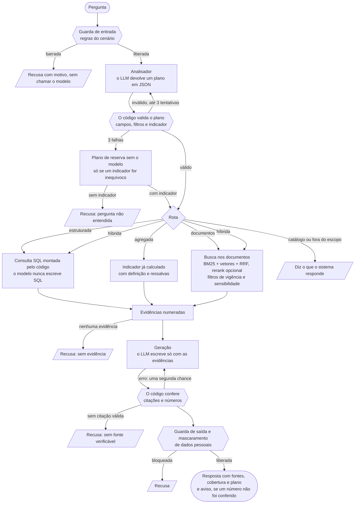
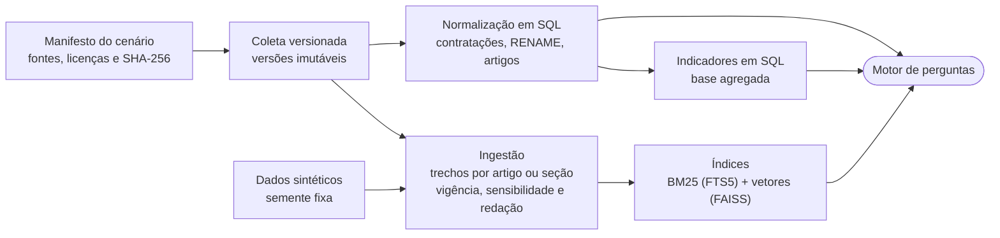

# Arquitetura

Este documento descreve o **desenho**. Ele foi escrito na fase 0 e nem tudo foi implementado: a API HTTP não existe (o `app/` é só uma tela em Streamlit), e o estágio `rerank` é opcional e vem desligado. O que foi feito, o que falta e as medições estão em [PROGRESSO.md](PROGRESSO.md) e [AVALIACAO.md](AVALIACAO.md).

## Princípio

O motor não conhece nenhum cenário. Tudo o que varia (fontes, personas, regras de sensibilidade, perguntas de avaliação) fica em `scenarios/<nome>/`, e o cenário ativo é escolhido por `--scenario` ou pela variável `SCENARIO`.

## Pipeline e estágios

Os estágios abaixo são os mesmos do diagrama, com o nome que cada um emite no log. Como os dados chegam ao motor:

Cada estágio emite uma linha de log JSONL com o mesmo nome (campo `stage`).

| # | Estágio (`stage`) | O que faz |
|---|---|---|
| 1 | `guardrail` | Regras determinísticas, antes de qualquer LLM: recusa recomendação comercial, prescrição individual, quebra de anonimato e perguntas fora do domínio. |
| 2 | `query_analysis` | A LLM classifica a pergunta e devolve um **plano em JSON** (rota, entidade, filtros, operações). O plano é validado por schema. |
| 3 | `roteamento` | O planejador determinístico valida o plano contra a **tabela de capacidades** de cada entidade e escolhe a rota. |
| 4 | `retrieval_bm25` | Busca lexical (SQLite FTS5), por base. |
| 5 | `retrieval_denso` | Busca vetorial (FAISS), por base. |
| 6 | `fusao_rrf` | Fusão das duas buscas por Reciprocal Rank Fusion, em código. |
| 7 | `rerank` | Cross-encoder (`bge-reranker-v2-m3`, ONNX int8) sobre os 10 melhores da fusão, lendo 256 tokens de cada. **Opcional, desligado por padrão** (`RERANK=true`): melhora o MRR e custa ~4 s por busca em CPU (veja AVALIACAO.md). |
| 8 | `geracao` | A LLM redige a resposta só com as evidências recuperadas, com fontes numeradas. |
| 9 | `validacao` | Confere citações, **números** (cada número da resposta tem de estar na evidência ou na pergunta; um erro volta ao modelo uma vez e, se persistir, a resposta sai com aviso), cobertura, dado pessoal e recusas. |
| 10 | `feedback` | Registra a avaliação do usuário. |

Rotas possíveis: estruturada, agregada, documentos, híbrida e catálogo.

## As quatro naturezas de evidência

| Natureza | Tratamento |
|---|---|
| Normativa | Chunk por artigo ou cláusula, com **data de publicação e de vigência** no metadado. Sem vigência, versões diferentes do mesmo texto se misturam. |
| Estruturada | Um registro é um chunk. Filtros por metadado são aplicados antes da busca semântica. |
| Conversacional | Sintética. Mascaramento de dado pessoal na ingestão. É onde moram as armadilhas de guardrail. |
| Agregada | Todo número carrega o recorte (período, unidade, fonte). Cálculos são feitos em SQL. |

## Decisões e o que as motivou

Estas decisões vêm de problemas observados no projeto em equipe `rag-contratacoes`. Cada uma terá um teste.

1. **Validar o plano contra a capacidade da entidade.** Um plano pediu um campo de data que a entidade não tem e a consulta quebrou. Plano com campo inexistente é corrigido para um válido (e registrado) ou rejeitado com mensagem clara.
2. **Erro de plano não é erro de infraestrutura.** Plano inválido responde 422 com a mensagem real. 503 só quando o banco ou o índice não abrem.
3. **O guardrail roda antes do analisador.** Recusa não pode depender de a LLM montar um plano válido.
4. **Busca por base.** Num índice único, uma base grande afoga uma pequena (os artigos da lei sumiram entre dezenas de milhares de contratos). Cada base é buscada separadamente e os resultados são fundidos depois.
5. **Embeddings não se misturam.** O identificador do índice inclui provedor, modelo e dimensão; o carregamento recusa índice incompatível.
6. **Cobertura declarada.** Resposta estruturada diz o período e o recorte cobertos e que zero resultado não prova inexistência.
7. **Granularidade temporal.** O construtor de consultas sabe agrupar por dia, mês e ano.
8. **Recuperação e geração medidas separadamente.** Para cada pergunta de avaliação: a fonte esperada está nos 5 primeiros? A resposta usa essa fonte?
9. **Variação da LLM medida.** Cada pergunta de avaliação roda 3 vezes e reporta-se a taxa de acerto.

## Módulos (fase 1 em diante)

| Módulo | Responsabilidade |
|---|---|
| `src/fetch_corpus.py` | `fetch`, `update` e `inventory`: coleta idempotente e retomável, versões imutáveis em `data/raw/vN`, inventário JSON e legível, diff entre versões. |
| `src/ingest.py` | Chunking, metadados, classificação de sensibilidade e mascaramento. |
| `src/index.py` | Embeddings com cache em disco e índices persistidos (carregar, nunca reindexar). |
| `src/router.py` | Analisador, validação do plano e escolha da rota. |
| `src/retrieve.py` | BM25, FAISS, RRF, filtros e a aplicação opcional do rerank. |
| `src/rerank.py` | Cross-encoder em ONNX (`onnxruntime` + `tokenizers`), sem PyTorch; não baixa nada. |
| `src/avaliar_rerank.py` | Ablação do custo do rerank: candidatos e tokens por trecho, com o tempo medido. |
| `src/generate.py` | Síntese com citações e guardrails de saída. |
| `src/numeros.py` | Conferência dos números da resposta contra a evidência. |
| `src/schema.py` | Modelos Pydantic (plano, resposta, chunk). |
| `src/obs.py` | Logs estruturados e contagem de tokens por estágio. |
| `src/capacidades.py` | Lê `scenarios/<id>/capacidades.yaml`: entidades, campos, filtros de documentos, regras de entrada e de saída. |
| `src/indicadores.py` | Base agregada: indicadores calculados em SQL, com definição e ressalvas. |
| `src/normalize.py`, `normalize_saude.py`, `normalize_openalex.py` | Normalização em tabelas SQL (PNCP, RENAME e protocolos, OpenAlex). |
| `src/pcdt_versoes.py` | Comparação de versões de um protocolo, seção por seção, em código. |
| `src/redacao.py`, `src/pii.py` | Redação de dados pessoais e sensíveis na ingestão e mascaramento. |
| `src/synth.py` | Bases conversacionais sintéticas (semente fixa). |
| `src/llm.py` | Cliente do modelo de linguagem (Groq, OpenAI ou Ollama) com repetição e leitura de tokens. |
| `src/avaliar.py`, `src/avaliar_respostas.py` | Avaliação da recuperação (com bootstrap) e da resposta final com repetições. |
| `app/` | Interface de perguntas em Streamlit (opcional). |

## Testes

Três camadas: unitário (serialização, split, filtros, RRF), contrato (todo chunk tem `source_file`, `doc_type`, `chunk_id`, `sensitivity` e `base_id`; recusa implica nenhuma fonte usada) e integração (marcada `llm`). As duas primeiras rodam offline, sobre fixtures pequenas, e passam em um clone limpo.

## Divisão de responsabilidades

Projeto individual. Autoria: Ester Neves.
