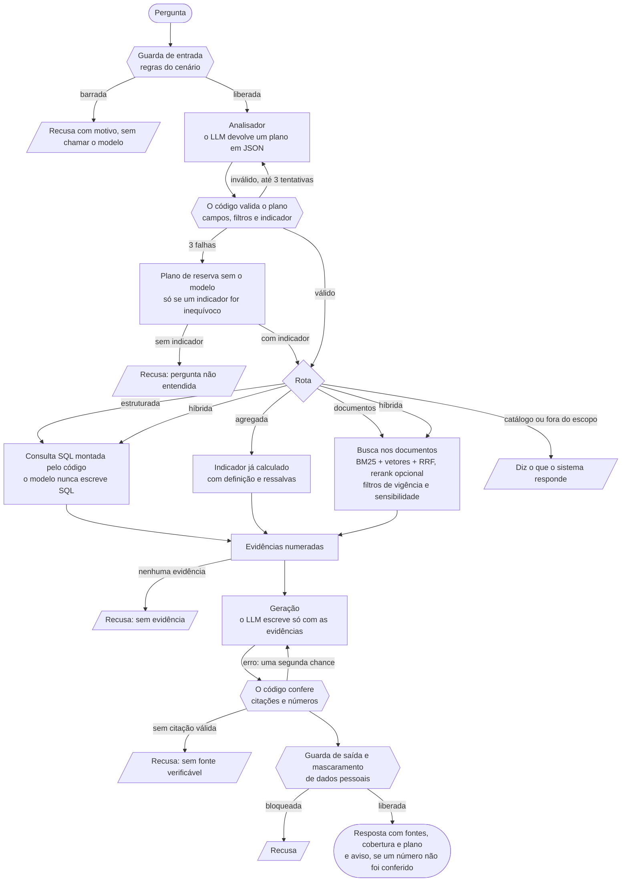
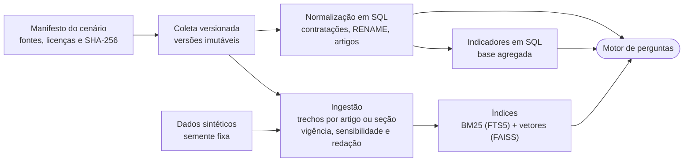

# rag-multicenario

Plataforma de **Adaptive RAG** com um motor único e três cenários configuráveis por manifesto: contratações públicas do Estado do Rio de Janeiro, saúde pública e pesquisa acadêmica.

O ponto central do projeto: o sistema decide **que tipo de evidência** responde à pergunta antes de buscar. Não roteia por palavra-chave. Três perguntas com quase o mesmo vocabulário podem ir para três bases diferentes.

> **Estado atual: motor e três cenários construídos; a avaliação formal (fase 5) está em parte feita.** A recuperação foi medida em 59 perguntas (inclusive com rerank opcional) e a resposta final, com 3 repetições, só na saúde; o RJ e a pesquisa esperam o limite diário da Groq. O motor tem configuração, esquemas, mascaramento de dados pessoais, logs estruturados, coleta versionada, ingestão em trechos, indexação (BM25, vetores e fusão RRF), normalização em SQL, bases agregadas de indicadores, bases conversacionais sintéticas, roteador com guardrails em camadas e geração de respostas com fontes numeradas e citações conferidas por código, tudo com testes (mais de 700). Um mesmo motor atende os três cenários: o que muda de um para outro está em `scenarios/<id>/` (manifesto do corpus, `capacidades.yaml` e `indicadores.yaml`). Foram feitas rodadas reais com um modelo de linguagem (Groq) nos cenários do RJ e da pesquisa, e uma rodada na saúde (13 perguntas × 3 repetições; a comparação PCDT x RENAME falhou, como previsto, e foi tratada depois com uma tabela própria, ainda sem nova rodada com o modelo). O que foi e o que não foi verificado está em [PROGRESSO.md](PROGRESSO.md).

## Estado dos cenários

| Cenário | Normativa | Estruturada | Agregada | Conversacional (sintética) | Estado |
|---|---|---|---|---|---|
| [Contratações públicas do RJ](scenarios/rj/README.md) | **indexada** (1.456 trechos) | **normalizada** (37 mil contratações, 46 mil contratos) | 7 indicadores | 20 atas e e-mails, 5 armadilhas | **rodada real feita** (RJ-04 instável) |
| [Saúde pública](scenarios/saude/README.md) | **indexada** (900 trechos de 8 PCDT de 4 doenças, com vigência por versão) | **RENAME 2024 normalizada** (996 linhas, 541 medicamentos) | 3 indicadores; dispensação recusada por decisão | 30 registros de ouvidoria, 6 armadilhas | **rodada real feita** (SA-10 falhou; correção feita, falta repetir) |
| [Pesquisa acadêmica](scenarios/pesquisa/README.md) | **indexada** (453 trechos) | **normalizada** (5.000 artigos) | 6 indicadores | 21 pareceres e e-mails, 7 armadilhas | **rodada real feita** |

Todos os dados trazem SHA-256 e inventário por versão. Os documentos conversacionais são **sintéticos** (gerados por script com semente fixa, marcados como fictícios) e ficam fora do Git, assim como os dados coletados.

## Como rodar (cenário RJ)

```bash
python -m src.fetch_corpus update --scenario rj --snapshot-db caminho/do/app.db   # coleta (opcional: snapshot)
python -m src.ingest --scenario rj          # normas em trechos
python -m src.index build --scenario rj     # índice de busca (precisa do Ollama para os vetores)
python -m src.normalize --scenario rj       # contratações e contratos em tabelas SQL
python -m src.indicadores build --scenario rj   # indicadores calculados em SQL (base agregada)
python -m src.generate --scenario rj "Quantas contratações por dispensa foram publicadas em janeiro de 2026?"
```

O cenário de saúde usa os mesmos comandos com `--scenario saude`, mais as bases sintéticas (`python -m src.synth build --scenario saude`, e o mesmo para `rj` e `pesquisa`). As avaliações estão em [AVALIACAO.md](AVALIACAO.md) (`python -m src.avaliar --scenario saude`).

O cenário de pesquisa usa os mesmos comandos com `--scenario pesquisa` (a coleta é `python -m src.fetch_corpus fetch --scenario pesquisa --base openalex_estruturado`).

**Rerank (opcional).** `pip install -r requirements-rerank.txt` e baixar para `data/models/bge-reranker-v2-m3-onnx/` dois arquivos de [onnx-community/bge-reranker-v2-m3-ONNX](https://huggingface.co/onnx-community/bge-reranker-v2-m3-ONNX): `onnx/model_int8.onnx` (544 MB, salvo como `model_int8.onnx`) e `tokenizer.json` (16 MB). Com eles, `python -m src.avaliar` mede o sistema `rrf_rerank`, e `RERANK=true` no `.env` liga o rerank no motor. O modelo original é o BAAI/bge-reranker-v2-m3 (Apache-2.0).

**Modelo local (opcional, só para testar o encadeamento).** `LLM_PROVIDER=ollama` roda o pipeline sem a Groq. O padrão é `qwen3:4b-instruct-2507-q4_K_M` (2,5 GB, Apache-2.0, sem raciocínio). Dois cuidados que medi: (1) o Ollama usa 4.096 tokens de contexto por padrão e os prompts daqui passam de 3.000 a 10.000; crie uma variante maior com um `Modelfile` (`FROM qwen3:4b-instruct-2507-q4_K_M` e `PARAMETER num_ctx 16384`, depois `ollama create qwen3-4b-instruct-16k -f Modelfile`) e use `LLM_MODEL=qwen3-4b-instruct-16k`; (2) modelos que raciocinam, como `qwen3:4b`, levam minutos numa pergunta simples em CPU, e o campo `reasoning_effort` só os silencia no modo JSON. Em CPU, um prompt de 10.000 tokens leva ~10 minutos só para ser lido (15 a 20 tokens por segundo). Um modelo de 4 bilhões de parâmetros erra a leitura da evidência (ver AVALIACAO.md): serve para checar plano, filtros e citações, **não** para medir qualidade.

**Interface (opcional).** `pip install -r requirements-app.txt` e `streamlit run app/streamlit_app.py`: uma tela com seletor de cenário, fontes, cobertura e o plano da consulta (veja [app/README.md](app/README.md)).

A geração usa a Groq por padrão (chave gratuita em console.groq.com, `GROQ_API_KEY` no `.env`); também funcionam a OpenAI (`LLM_PROVIDER=openai`) e um modelo local (`LLM_PROVIDER=ollama`). A Groq não oferece embeddings, então os vetores continuam no Ollama local. Sem pergunta na linha de comando, `src.generate` abre um modo interativo. Cada etapa fica registrada em `logs/pipeline-AAAA-MM-DD.jsonl`.

## Testes, lint e cobertura

```bash
pip install -r requirements-dev.txt
python -m pytest                     # mais de 750 testes, sem rede e sem modelo de linguagem
ruff check .                         # lint (regras E, F, W, I, B, UP; configuração em pyproject.toml)
coverage run -m pytest && coverage report
```

Cobertura medida em 16/11: **96%** das linhas de `src/`, `app/` e `config.py` (4.675 linhas; era 89% antes de se testarem as linhas de comando e o laço da avaliação). O que ficou sem teste são, sobretudo, ramos de erro de leitura de arquivo e de rede em `ingest`, `fetch_corpus`, `indicadores` e `synth`, o caminho que carrega o modelo de rerank de verdade (`src/rerank.py`, 88%) e a rotina de `llm.py` que espera a resposta do provedor (91%). O CI roda o lint e exige ao menos 85% de cobertura. Os testes não chamam modelo de linguagem de verdade (o `-m llm` os liga).

## Como o sistema pensa

**Da pergunta à resposta.** O que o código decide e o que o modelo de linguagem decide:



**Como os dados chegam ao motor.** Tudo o que varia entre os cenários fica no manifesto, nos indicadores e nas capacidades de `scenarios/<id>/`:



Decisões que o projeto mantém:

- **A LLM não escreve SQL.** Ela só preenche um plano validado por schema; o banco recebe campos permitidos e parâmetros protegidos.
- **Duas buscas combinadas:** BM25 (SQLite FTS5) e FAISS (embeddings), fundidas por RRF em código. A ablação (BM25, vetores e RRF) está medida em [AVALIACAO.md](AVALIACAO.md); o rerank por cross-encoder está implementado como **opção desligada** (melhora o MRR em +0,10, ao custo de ~19 s por busca em CPU; veja "Rerank (opcional)" abaixo).
- **Sensibilidade classificada na ingestão**, nunca na hora de responder. CPF, telefone e e-mail pessoal são mascarados antes de indexar.
- **Cálculos numéricos em código (SQL)**, não pelo modelo.
- **Sem evidência, o sistema diz que não sabe.** Não acusa e não emite juízo jurídico ou clínico.

Detalhes em [ARQUITETURA.md](ARQUITETURA.md).

## Limitações conhecidas

Ditas aqui porque o projeto é um portfólio e o que não funciona importa tanto quanto o que funciona. Os detalhes e os números estão em [PROGRESSO.md](PROGRESSO.md) e [AVALIACAO.md](AVALIACAO.md).

- **Rerank só medido na ordenação dos trechos.** Não foi medido na resposta final e custa ~19 s por busca em CPU, por isso fica desligado por padrão.
- **Avaliação pequena.** A recuperação foi medida em 59 perguntas escritas por mim (34 + 25 de um segundo conjunto), e as diferenças entre BM25, vetores e RRF não são estatisticamente conclusivas; só o efeito do filtro de vigência e de doença e o do rerank têm intervalo sem zero. A resposta final foi medida com 3 repetições só no cenário de saúde; o RJ e a pesquisa esperam o limite diário da Groq.
- **Falhas previstas que continuam.** A comparação entre o que um protocolo clínico cita e o que a RENAME lista (SA-10) passou a ter uma tabela própria (`pcdt_medicamento`), testada na consulta mas ainda não repetida com o modelo; ela cobre as cinco versões de protocolo do corpus, mas só os medicamentos que cada protocolo enumera, e o RJ-04 (contratações diretas e proporção) oscilava porque o modelo às vezes errava o plano três vezes seguidas. Agora, nesse caso, um plano de reserva sem o modelo usa o indicador pronto (testado por teste unitário, ainda não repetido com o modelo). A memória de conversa ("desses", "e em 2025?") foi implementada com **um turno** de memória e testada com um modelo simulado, mas **não foi conferida com o modelo real**: se o PE-02 passa a funcionar depende de a LLM reaproveitar bem os filtros do plano anterior.
- **Redação de dado sensível.** A remoção de trechos que identificam pessoas só pega o que as regras conhecem: em frases novas, que as regras nunca viram, protegeu **13 de 30 (43%)** das sensíveis e não alterou nenhuma de 12 comuns; ajustar as regras às falhas medidas não melhorou isso (as regras não generalizam). É uma primeira camada, não serve para dados reais (veja AVALIACAO.md).
- **Os cenários conversacionais são sintéticos.** Pessoas, órgãos e números são fictícios, gerados com semente fixa.
- **Os dados são um recorte datado.** Quatro doenças na saúde, uma amostra de artigos na pesquisa, e a RENAME de dezembro de 2024. Nada aqui substitui orientação clínica, jurídica ou profissional.
- **Interface mínima.** O `app/` é uma tela de perguntas em Streamlit, sem login, histórico entre sessões nem API HTTP; lembra só o turno anterior.

## Estrutura do repositório

```text
README.md              vitrine e estado real dos cenários
ARQUITETURA.md         pipeline, estágios e decisões (desenho; ver o aviso no topo)
AVALIACAO.md           ablação da recuperação e resposta final com repetições
LICENSE                MIT
PROGRESSO.md           o que está pronto, o que falta e decisões tomadas
.env.example           variáveis necessárias, sem valores reais
scenarios/<nome>/      tudo o que varia por cenário
    README.md  corpus_manifest.yaml  PERSONAS.md
    sensibilidade.yaml  capacidades.yaml  indicadores.yaml
    eval/questions.json  eval/retrieval_gold.json  eval/respostas.json
src/                   motor único, sem nada específico de cenário
app/                   interface de perguntas em Streamlit (uma tela; sem API HTTP)
tests/                 testes unitários e de contrato (mais de 700)
data/inventory/        inventário de cada coleta (os dados em si não vão para o Git)
```

## Como este projeto se relaciona com o repositório em equipe

Este projeto parte de uma ideia desenvolvida em grupo na residência TIC em Trilhas (PUC-Rio e Instituto ECOA). A versão em equipe, com um cenário, está em [rag-contratacoes](https://github.com/EsterNevess/rag-contratacoes). Aqui o código é novo e individual.

| | rag-contratacoes | rag-multicenario |
|---|---|---|
| Natureza | trabalho em equipe | trabalho individual |
| Escopo | contratações do RJ | três cenários |
| Código | do grupo, com ajustes meus | escrito do zero |
| O que mostra | trabalhar em equipe num projeto real | desenhar e construir um sistema sozinha |

O que veio da ideia do grupo: a arquitetura de Adaptive RAG e o cenário de contratações. O que é novo aqui: o motor reescrito, os outros dois cenários, o roteamento por tipo de evidência, a avaliação por persona e a ablação das buscas.

## Créditos

A proposta dos cenários e o padrão de engenharia (manifesto do corpus, versionamento, logs e testes) vêm do material do Grande Desafio de IA Generativa e RAG da residência TIC em Trilhas (PUC-Rio, Instituto ECOA). As fontes de dados são públicas (PNCP, Planalto, OpenAlex, entre outras) e cada uma é descrita no manifesto do cenário. Nenhum código do repositório do grupo foi copiado.

Os integrantes do Time 03 estão listados no [rag-contratacoes](https://github.com/EsterNevess/rag-contratacoes#créditos).

## Licença

Código e textos sob a licença [MIT](LICENSE). Os dados coletados não fazem parte do repositório: cada fonte (PNCP, Planalto, OpenAlex, Ministério da Saúde, FAPERJ, CNPq e outras) mantém os seus próprios termos de uso, e o manifesto de cada cenário registra a origem e a licença declarada. [DADOS_E_LICENCAS.md](DADOS_E_LICENCAS.md) reúne as fontes, os modelos e as dependências com as licenças, e o que não foi conferido. Dois pontos pedem atenção: a dependência **PyMuPDF é AGPL-3.0** (ou licença comercial), o que importa a quem hospedar o app como serviço; e, com a Groq ou a OpenAI como provedor, **as perguntas e os trechos de evidência saem do seu computador** para o provedor.
