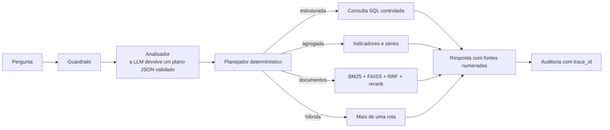

# rag-multicenario

Plataforma de **Adaptive RAG** com um motor único e três cenários configuráveis por manifesto: contratações públicas do Estado do Rio de Janeiro, saúde pública e pesquisa acadêmica.

O ponto central do projeto: o sistema decide **que tipo de evidência** responde à pergunta antes de buscar. Não roteia por palavra-chave. Três perguntas com quase o mesmo vocabulário podem ir para três bases diferentes.

> **Estado atual: fase 0 (desenho).** Os três cenários estão desenhados (manifestos, personas e perguntas de avaliação), mas ainda não há motor funcionando. A tabela abaixo mostra o estado real de cada cenário e é atualizada no fim de cada fase.

## Estado dos cenários

| Cenário | Normativa | Estruturada | Agregada | Conversacional | Estado |
|---|---|---|---|---|---|
| [Contratações públicas do RJ](scenarios/rj/README.md) | desenhada | desenhada | desenhada | desenhada (sintética) | **planejado, é a próxima fase** |
| [Saúde pública](scenarios/saude/README.md) | desenhada | desenhada | desenhada | desenhada (sintética) | planejado |
| [Pesquisa acadêmica](scenarios/pesquisa/README.md) | desenhada | desenhada | desenhada | desenhada (sintética) | planejado |

"Desenhada" quer dizer: fonte, forma de acesso e regras de sensibilidade estão no manifesto, e há perguntas de avaliação. **Nenhum dado foi coletado ainda e nenhum código do motor foi escrito.**

## Como o sistema pensa



Decisões que o projeto mantém:

- **A LLM não escreve SQL.** Ela só preenche um plano validado por schema; o banco recebe campos permitidos e parâmetros protegidos.
- **Duas buscas combinadas:** BM25 (SQLite FTS5) e FAISS (embeddings), fundidas por RRF em código, com rerank por cross-encoder e ablação medida.
- **Sensibilidade classificada na ingestão**, nunca na hora de responder. CPF, telefone e e-mail pessoal são mascarados antes de indexar.
- **Cálculos numéricos em código (SQL)**, não pelo modelo.
- **Sem evidência, o sistema diz que não sabe.** Não acusa e não emite juízo jurídico ou clínico.

Detalhes em [ARQUITETURA.md](ARQUITETURA.md).

## Estrutura do repositório

```text
README.md              vitrine e estado real dos cenários
ARQUITETURA.md         pipeline, estágios e decisões
PROGRESSO.md           o que está pronto, o que falta e decisões tomadas
.env.example           variáveis necessárias, sem valores reais
scenarios/<nome>/      tudo o que varia por cenário
    README.md  corpus_manifest.yaml  PERSONAS.md
    sensibilidade.yaml  eval/questions.json
src/                   motor único, sem nada específico de cenário (fase 1)
app/                   API e console (fase 1)
tests/                 testes unitários, de contrato e de integração (fase 1)
data/inventory/        inventário de cada coleta (os dados em si não vão para o Git)
```

## Como este projeto se relaciona com o repositório em equipe

Este projeto parte de uma ideia desenvolvida em grupo na residência TIC em Trilhas (PUC-Rio e Instituto ECOA). A versão em equipe, com um cenário, está em [rag-contratacoes](https://github.com/EsterNevess/rag-contratacoes). Aqui o código é novo e individual.

| | rag-contratacoes | rag-multicenario |
|---|---|---|
| Natureza | trabalho em equipe | trabalho individual |
| Escopo | contratações do RJ | três cenários |
| Código | do grupo, com ajustes meus | escrito do zero |
| O que mostra | trabalhar em equipe num projeto real | desenhar e construir um sistema sozinha |

O que veio da ideia do grupo: a arquitetura de Adaptive RAG e o cenário de contratações. O que é novo aqui: o motor reescrito, os outros dois cenários, o roteamento por tipo de evidência, a avaliação por persona e a ablação das buscas.

## Créditos

A proposta dos cenários e o padrão de engenharia (manifesto do corpus, versionamento, logs e testes) vêm do material do Grande Desafio de IA Generativa e RAG da residência TIC em Trilhas (PUC-Rio, Instituto ECOA). As fontes de dados são públicas (PNCP, Planalto, OpenAlex, entre outras) e cada uma é descrita no manifesto do cenário. Nenhum código do repositório do grupo foi copiado.

Os integrantes do Time 03 estão listados no [rag-contratacoes](https://github.com/EsterNevess/rag-contratacoes#créditos).
