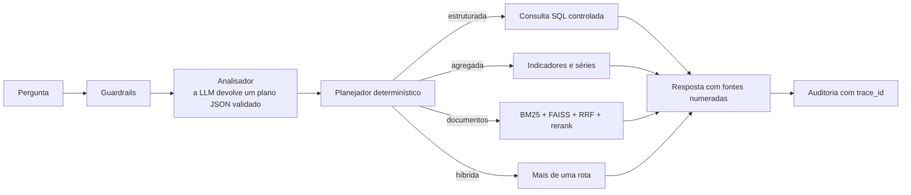

# rag-multicenario

Plataforma de **Adaptive RAG** com um motor único e três cenários configuráveis por manifesto: contratações públicas do Estado do Rio de Janeiro, saúde pública e pesquisa acadêmica.

O ponto central do projeto: o sistema decide **que tipo de evidência** responde à pergunta antes de buscar. Não roteia por palavra-chave. Três perguntas com quase o mesmo vocabulário podem ir para três bases diferentes.

> **Estado atual: motor pronto com dois cenários coletados; falta a rodada real com um modelo.** Do motor existem a configuração, os esquemas, o mascaramento de dados pessoais, os logs estruturados, a coleta versionada, a ingestão em trechos, a indexação, a busca (BM25, vetores e fusão RRF), a normalização da base estruturada em SQL, o roteador com guardrails e a geração de respostas com fontes numeradas, tudo com testes (323). Um mesmo motor atende dois cenários: o que muda de um para outro está em `scenarios/<id>/` (manifesto do corpus e `capacidades.yaml`). Ainda não foi feita a rodada completa com um modelo de verdade: ela depende de uma chave de API e de normalizar a coleta v3. A tabela abaixo mostra o estado real de cada cenário e é atualizada no fim de cada fase.

## Estado dos cenários

| Cenário | Normativa | Estruturada | Agregada | Conversacional | Estado |
|---|---|---|---|---|---|
| [Contratações públicas do RJ](scenarios/rj/README.md) | **coletada e indexada** (1.458 trechos) | **coletada e normalizada** (37 mil contratações, 46 mil contratos) | desenhada | desenhada (sintética) | **código pronto, falta a rodada real (fase 1)** |
| [Saúde pública](scenarios/saude/README.md) | desenhada | desenhada | desenhada | desenhada (sintética) | planejado |
| [Pesquisa acadêmica](scenarios/pesquisa/README.md) | desenhada | **coletada e normalizada** (5.000 artigos) | desenhada | desenhada (sintética) | **em andamento (fase 2)** |

"Desenhada" quer dizer: fonte, forma de acesso e regras de sensibilidade estão no manifesto, e há perguntas de avaliação. **Dados até agora:** a base normativa do RJ (13 documentos, cortada em 1.458 trechos), as bases estruturadas do RJ (2026) e da pesquisa (OpenAlex, 2020 a 2024), todas com SHA-256 e inventário por versão.

## Como rodar (cenário RJ)

```bash
python -m src.fetch_corpus update --scenario rj --snapshot-db caminho/do/app.db   # coleta (opcional: snapshot)
python -m src.ingest --scenario rj          # normas em trechos
python -m src.index build --scenario rj     # índice de busca (precisa do Ollama para os vetores)
python -m src.normalize --scenario rj       # contratações e contratos em tabelas SQL
python -m src.generate --scenario rj "Quantas contratações por dispensa foram publicadas em janeiro de 2026?"
```

O cenário de pesquisa usa os mesmos comandos com `--scenario pesquisa` (a coleta é `python -m src.fetch_corpus fetch --scenario pesquisa --base openalex_estruturado`).

A geração usa a OpenAI por padrão (`OPENAI_API_KEY` no `.env`) ou um modelo local com `LLM_PROVIDER=ollama`. Sem pergunta na linha de comando, `src.generate` abre um modo interativo. Cada etapa fica registrada em `logs/pipeline-AAAA-MM-DD.jsonl`.

## Como o sistema pensa



Decisões que o projeto mantém:

- **A LLM não escreve SQL.** Ela só preenche um plano validado por schema; o banco recebe campos permitidos e parâmetros protegidos.
- **Duas buscas combinadas:** BM25 (SQLite FTS5) e FAISS (embeddings), fundidas por RRF em código, com rerank por cross-encoder e ablação medida.
- **Sensibilidade classificada na ingestão**, nunca na hora de responder. CPF, telefone e e-mail pessoal são mascarados antes de indexar.
- **Cálculos numéricos em código (SQL)**, não pelo modelo.
- **Sem evidência, o sistema diz que não sabe.** Não acusa e não emite juízo jurídico ou clínico.

Detalhes em [ARQUITETURA.md](ARQUITETURA.md).

## Estrutura do repositório

```text
README.md              vitrine e estado real dos cenários
ARQUITETURA.md         pipeline, estágios e decisões
PROGRESSO.md           o que está pronto, o que falta e decisões tomadas
.env.example           variáveis necessárias, sem valores reais
scenarios/<nome>/      tudo o que varia por cenário
    README.md  corpus_manifest.yaml  PERSONAS.md
    sensibilidade.yaml  eval/questions.json
src/                   motor único, sem nada específico de cenário (fase 1)
app/                   API e console (fase 1)
tests/                 testes unitários, de contrato e de integração (fase 1)
data/inventory/        inventário de cada coleta (os dados em si não vão para o Git)
```

## Como este projeto se relaciona com o repositório em equipe

Este projeto parte de uma ideia desenvolvida em grupo na residência TIC em Trilhas (PUC-Rio e Instituto ECOA). A versão em equipe, com um cenário, está em [rag-contratacoes](https://github.com/EsterNevess/rag-contratacoes). Aqui o código é novo e individual.

| | rag-contratacoes | rag-multicenario |
|---|---|---|
| Natureza | trabalho em equipe | trabalho individual |
| Escopo | contratações do RJ | três cenários |
| Código | do grupo, com ajustes meus | a escrever do zero (fase 1) |
| O que mostra | trabalhar em equipe num projeto real | desenhar e construir um sistema sozinha (em andamento) |

O que veio da ideia do grupo: a arquitetura de Adaptive RAG e o cenário de contratações. O que será novo aqui: o motor reescrito, os outros dois cenários, o roteamento por tipo de evidência, a avaliação por persona e a ablação das buscas.

## Créditos

A proposta dos cenários e o padrão de engenharia (manifesto do corpus, versionamento, logs e testes) vêm do material do Grande Desafio de IA Generativa e RAG da residência TIC em Trilhas (PUC-Rio, Instituto ECOA). As fontes de dados são públicas (PNCP, Planalto, OpenAlex, entre outras) e cada uma é descrita no manifesto do cenário. Nenhum código do repositório do grupo foi copiado.

Os integrantes do Time 03 estão listados no [rag-contratacoes](https://github.com/EsterNevess/rag-contratacoes#créditos).
