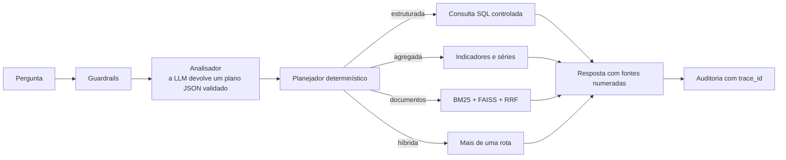

# rag-multicenario

Plataforma de **Adaptive RAG** com um motor único e três cenários configuráveis por manifesto: contratações públicas do Estado do Rio de Janeiro, saúde pública e pesquisa acadêmica.

O ponto central do projeto: o sistema decide **que tipo de evidência** responde à pergunta antes de buscar. Não roteia por palavra-chave. Três perguntas com quase o mesmo vocabulário podem ir para três bases diferentes.

> **Estado atual: motor e três cenários construídos; a avaliação formal (fase 5) ainda não foi feita.** O motor tem configuração, esquemas, mascaramento de dados pessoais, logs estruturados, coleta versionada, ingestão em trechos, indexação (BM25, vetores e fusão RRF), normalização em SQL, bases agregadas de indicadores, bases conversacionais sintéticas, roteador com guardrails em camadas e geração de respostas com fontes numeradas e citações conferidas por código, tudo com testes (613). Um mesmo motor atende os três cenários: o que muda de um para outro está em `scenarios/<id>/` (manifesto do corpus, `capacidades.yaml` e `indicadores.yaml`). Foram feitas rodadas reais com um modelo de linguagem (Groq) nos cenários do RJ e da pesquisa, e uma rodada na saúde (8 de 10 perguntas certas ou plausíveis; a comparação PCDT x RENAME falhou, como previsto). O que foi e o que não foi verificado está em [PROGRESSO.md](PROGRESSO.md).

## Estado dos cenários

| Cenário | Normativa | Estruturada | Agregada | Conversacional (sintética) | Estado |
|---|---|---|---|---|---|
| [Contratações públicas do RJ](scenarios/rj/README.md) | **indexada** (1.456 trechos) | **normalizada** (37 mil contratações, 46 mil contratos) | 7 indicadores | 20 atas e e-mails, 5 armadilhas | **rodada real feita** (RJ-04 instável) |
| [Saúde pública](scenarios/saude/README.md) | **indexada** (635 trechos de 6 PCDT de 3 doenças, com vigência por versão) | **RENAME 2024 normalizada** (996 linhas, 541 medicamentos) | 3 indicadores; dispensação recusada por decisão | 30 registros de ouvidoria, 6 armadilhas | **rodada real feita** (SA-10 falha) |
| [Pesquisa acadêmica](scenarios/pesquisa/README.md) | **indexada** (453 trechos) | **normalizada** (5.000 artigos) | 6 indicadores | 21 pareceres e e-mails, 7 armadilhas | **rodada real feita** |

Todos os dados trazem SHA-256 e inventário por versão. Os documentos conversacionais são **sintéticos** (gerados por script com semente fixa, marcados como fictícios) e ficam fora do Git, assim como os dados coletados.

## Como rodar (cenário RJ)

```bash
python -m src.fetch_corpus update --scenario rj --snapshot-db caminho/do/app.db   # coleta (opcional: snapshot)
python -m src.ingest --scenario rj          # normas em trechos
python -m src.index build --scenario rj     # índice de busca (precisa do Ollama para os vetores)
python -m src.normalize --scenario rj       # contratações e contratos em tabelas SQL
python -m src.indicadores build --scenario rj   # indicadores calculados em SQL (base agregada)
python -m src.generate --scenario rj "Quantas contratações por dispensa foram publicadas em janeiro de 2026?"
```

O cenário de saúde usa os mesmos comandos com `--scenario saude`, mais as bases sintéticas (`python -m src.synth build --scenario saude`, e o mesmo para `rj` e `pesquisa`). As avaliações estão em [AVALIACAO.md](AVALIACAO.md) (`python -m src.avaliar --scenario saude`).

O cenário de pesquisa usa os mesmos comandos com `--scenario pesquisa` (a coleta é `python -m src.fetch_corpus fetch --scenario pesquisa --base openalex_estruturado`).

A geração usa a Groq por padrão (chave gratuita em console.groq.com, `GROQ_API_KEY` no `.env`); também funcionam a OpenAI (`LLM_PROVIDER=openai`) e um modelo local (`LLM_PROVIDER=ollama`). A Groq não oferece embeddings, então os vetores continuam no Ollama local. Sem pergunta na linha de comando, `src.generate` abre um modo interativo. Cada etapa fica registrada em `logs/pipeline-AAAA-MM-DD.jsonl`.

## Como o sistema pensa



Decisões que o projeto mantém:

- **A LLM não escreve SQL.** Ela só preenche um plano validado por schema; o banco recebe campos permitidos e parâmetros protegidos.
- **Duas buscas combinadas:** BM25 (SQLite FTS5) e FAISS (embeddings), fundidas por RRF em código. A ablação (BM25, vetores e RRF) está medida em [AVALIACAO.md](AVALIACAO.md); o rerank por cross-encoder está previsto e **não foi implementado**.
- **Sensibilidade classificada na ingestão**, nunca na hora de responder. CPF, telefone e e-mail pessoal são mascarados antes de indexar.
- **Cálculos numéricos em código (SQL)**, não pelo modelo.
- **Sem evidência, o sistema diz que não sabe.** Não acusa e não emite juízo jurídico ou clínico.

Detalhes em [ARQUITETURA.md](ARQUITETURA.md).

## Limitações conhecidas

Ditas aqui porque o projeto é um portfólio e o que não funciona importa tanto quanto o que funciona. Os detalhes e os números estão em [PROGRESSO.md](PROGRESSO.md) e [AVALIACAO.md](AVALIACAO.md).

- **Rerank não implementado.** A comparação "RRF + rerank" da avaliação não foi feita.
- **Avaliação pequena.** A recuperação foi medida em 34 perguntas escritas por mim, e as diferenças entre BM25, vetores e RRF não são estatisticamente conclusivas. A resposta final foi medida com 3 repetições só no cenário de saúde; o RJ e a pesquisa esperam o limite diário da Groq.
- **Falhas previstas que continuam.** A comparação entre o que um protocolo clínico cita e o que a RENAME lista (SA-10) passou a ter uma tabela própria (`pcdt_medicamento`), testada na consulta mas ainda não repetida com o modelo; ela cobre só Parkinson e a artrite reumatoide de 2017 a 2021, e o RJ-04 (contratações diretas e proporção) oscilava porque o modelo às vezes errava o plano três vezes seguidas. Agora, nesse caso, um plano de reserva sem o modelo usa o indicador pronto (testado por teste unitário, ainda não repetido com o modelo). Sem memória de conversa, "desses" na segunda pergunta (PE-02) não funciona.
- **Redação de dado sensível.** A remoção de trechos que identificam pessoas em registros sintéticos só pega o que as regras conhecem; a cobertura em texto novo é desconhecida.
- **Os cenários conversacionais são sintéticos.** Pessoas, órgãos e números são fictícios, gerados com semente fixa.
- **Os dados são um recorte datado.** Três doenças na saúde, uma amostra de artigos na pesquisa, e a RENAME de dezembro de 2024. Nada aqui substitui orientação clínica, jurídica ou profissional.
- **API e console (`app/`) não existem**: o uso é pela linha de comando.

## Estrutura do repositório

```text
README.md              vitrine e estado real dos cenários
ARQUITETURA.md         pipeline, estágios e decisões (desenho; ver o aviso no topo)
AVALIACAO.md           ablação da recuperação e resposta final com repetições
LICENSE                MIT
PROGRESSO.md           o que está pronto, o que falta e decisões tomadas
.env.example           variáveis necessárias, sem valores reais
scenarios/<nome>/      tudo o que varia por cenário
    README.md  corpus_manifest.yaml  PERSONAS.md
    sensibilidade.yaml  capacidades.yaml  indicadores.yaml
    eval/questions.json  eval/retrieval_gold.json  eval/respostas.json
src/                   motor único, sem nada específico de cenário
app/                   API e console: **não implementados** (só o README)
tests/                 testes unitários e de contrato (648)
data/inventory/        inventário de cada coleta (os dados em si não vão para o Git)
```

## Como este projeto se relaciona com o repositório em equipe

Este projeto parte de uma ideia desenvolvida em grupo na residência TIC em Trilhas (PUC-Rio e Instituto ECOA). A versão em equipe, com um cenário, está em [rag-contratacoes](https://github.com/EsterNevess/rag-contratacoes). Aqui o código é novo e individual.

| | rag-contratacoes | rag-multicenario |
|---|---|---|
| Natureza | trabalho em equipe | trabalho individual |
| Escopo | contratações do RJ | três cenários |
| Código | do grupo, com ajustes meus | escrito do zero |
| O que mostra | trabalhar em equipe num projeto real | desenhar e construir um sistema sozinha |

O que veio da ideia do grupo: a arquitetura de Adaptive RAG e o cenário de contratações. O que é novo aqui: o motor reescrito, os outros dois cenários, o roteamento por tipo de evidência, a avaliação por persona e a ablação das buscas.

## Créditos

A proposta dos cenários e o padrão de engenharia (manifesto do corpus, versionamento, logs e testes) vêm do material do Grande Desafio de IA Generativa e RAG da residência TIC em Trilhas (PUC-Rio, Instituto ECOA). As fontes de dados são públicas (PNCP, Planalto, OpenAlex, entre outras) e cada uma é descrita no manifesto do cenário. Nenhum código do repositório do grupo foi copiado.

Os integrantes do Time 03 estão listados no [rag-contratacoes](https://github.com/EsterNevess/rag-contratacoes#créditos).

## Licença

Código e textos sob a licença [MIT](LICENSE). Os dados coletados não fazem parte do repositório: cada fonte (PNCP, Planalto, OpenAlex, Ministério da Saúde, FAPERJ, CNPq e outras) mantém os seus próprios termos de uso, e o manifesto de cada cenário registra a origem e a licença declarada.
